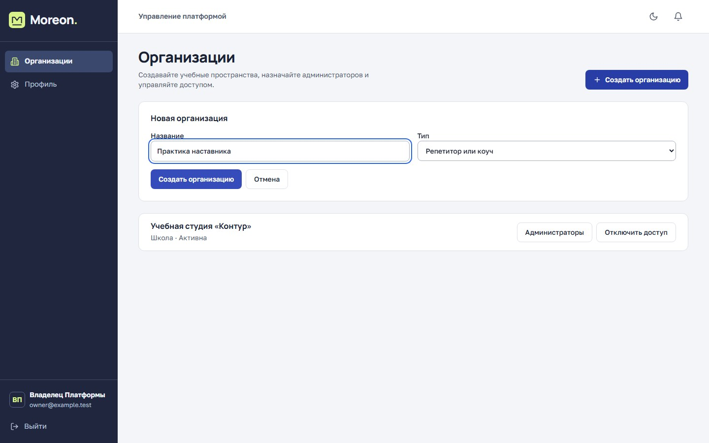
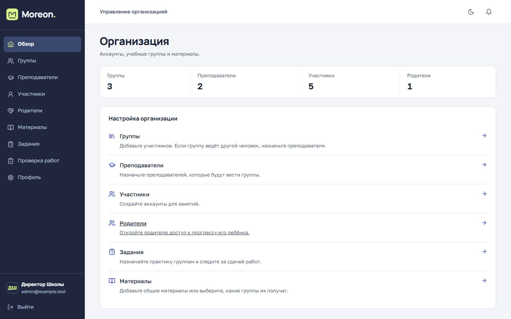
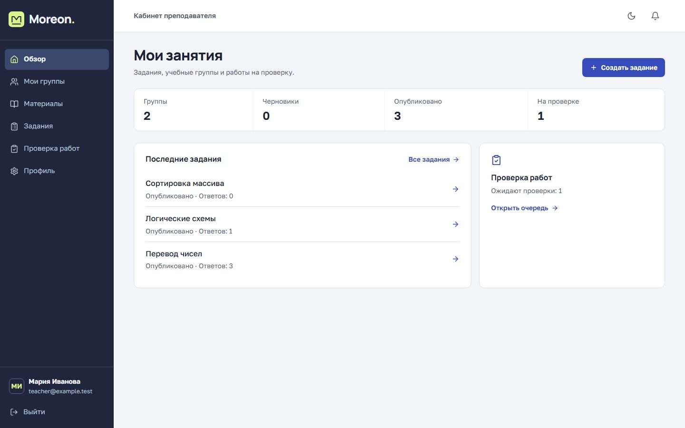
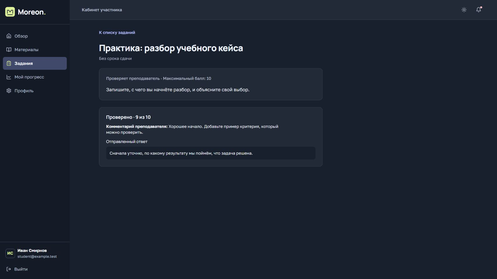
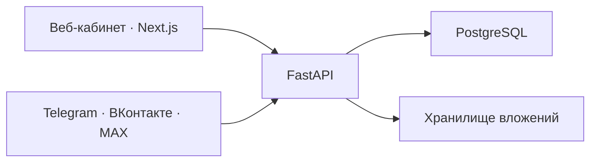

# Moreon

**Кабинет для учебных групп.** Школа распределяет группы между преподавателями, а наставник может сам вести занятия и управлять доступом. Материалы, задания, ответы и оценки остаются в кабинете группы.

[Создание кабинета](#создание-кабинета) · [Работа с группой](#работа-с-группой) · [Архитектура](#архитектура) · [Защита данных](#защита-данных) · [Установка](#установка-на-своём-сервере)

## Создание кабинета

Владелец платформы указывает название и тип организации. В форме доступны «Репетитор или коуч», «Школа», «Вуз», «Компания» и «Другое». Тип сохраняется в карточке организации. Группы, состав участников, преподавателей и учебные материалы администратор настраивает под свой формат работы.

*Все скриншоты сделаны в работающем Moreon с демонстрационными данными.*

## Работа с группой

**Школа или вуз.** Администратор создаёт группы, добавляет участников по списку и назначает преподавателей. Преподаватель работает со своими группами. При необходимости администратор связывает аккаунт родителя с учеником, чтобы родитель мог посмотреть его прогресс.

**Частная практика.** Наставник может создать группу, выложить материалы, выдать задания и проверить ответы из одного кабинета. Если он ведёт группу сам, отдельный аккаунт преподавателя для этого не нужен.

Преподаватель указывает срок и публикует задание для выбранной группы. Короткий текстовый ответ можно сверять с эталоном автоматически. При ручной проверке преподаватель ставит балл, оставляет комментарий или отправляет работу на доработку. Участник видит ответ и результат на странице задания.

### Когда Moreon подходит

- **Группа ведёт часть работы в мессенджере.** Участник может открыть задания и отправить текстовый ответ боту. Преподаватель получает ответы из чата и с сайта в одной очереди.
- **За группы отвечают разные люди.** Администратор распределяет доступ, а преподаватель ведёт занятия и проверяет работы своих групп.
- **Нужна установка на своём сервере.** Организация выбирает, где разместить кабинет, базу и вложения, и может восстановить их из резервной копии.

## Архитектура

Веб-интерфейс на Next.js и адаптеры мессенджеров работают с одним API на FastAPI. PostgreSQL хранит организации, участников, задания, ответы и оценки. Файлы лежат в отдельном томе, а API хранит их связь с работами и материалами.

Telegram и ВКонтакте получают сообщения через long polling. MAX принимает их через HTTPS-вебхук. Каналы подключаются отдельно. Для привязки аккаунта участник отправляет боту одноразовый код из профиля. Вложения и проверка работ остаются в веб-кабинете.

## Защита данных

- **Доступ проверяет API.** Он сверяет роль и связь пользователя с организацией, группой или работой. Родитель видит прогресс только связанного ученика. Ссылка на файл сама по себе не даёт права на скачивание.
- **Пароли хранятся в виде хешей bcrypt.** Веб-сеанс использует cookie с флагом `HttpOnly`. В рабочей установке HTTPS и параметр `Secure` включаются через конфигурацию сервера. Сброс пароля закрывает активные сеансы и отвязывает мессенджеры.
- **База и файлы доступны сервисам внутри установки.** На сервере наружу выводится веб-кабинет через HTTPS-прокси. Восстановление базы и вложений из одной копии можно проверить в отдельной установке.

Автоматическая проверка чистой установки проходит сценарии школы и самостоятельного наставника от создания группы до оценки. Она также проверяет, что посторонний преподаватель не может выставить оценку, а родитель без связи с учеником не может открыть его прогресс.

## Установка на своём сервере

Docker Compose запускает веб-кабинет, API и PostgreSQL. Администратор сервера настраивает домен и HTTPS, создаёт аккаунт владельца и выбирает нужные каналы связи. Перед обновлением сохраняют базу и вложения. Восстановление можно сначала проверить на отдельном экземпляре.

Чтобы обсудить пилот, развёртывание или получить доступ к исходному коду, напишите через 24projects. Укажите, для кого нужен кабинет и где планируете его разместить. [Связаться с командой](https://24projects.ru/projects/project-280dd2e2-06ad-4c16-bdb5-156d7e8e5027#contact)
